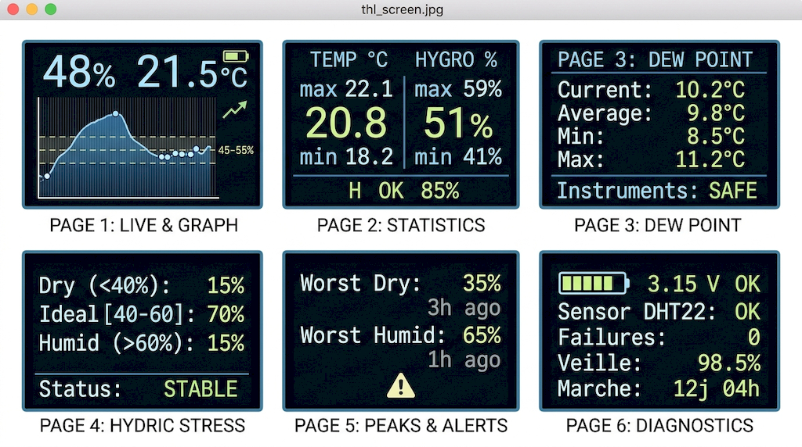

# Temperature & Humidity Station for Home Studio & Lutherie 🎸🌡️

An intelligent, energy-efficient, and ultra-precise measurement station specifically designed to monitor the environment of musical instruments (guitars, violins, solid woods) and home studios. Developed on a **FireBeetle ESP8266** with a **DHT22** sensor and an **OLED SSD1306 (0.96")** display, it features advanced battery management and a comprehensive multi-page interface.

---

## 🎯 A project for musicians, luthiers, and home studios?

Stringed instruments and solid wood items (acoustic and classical guitars, violins, cellos) react instantly to humidity variations:

* **Below 40% humidity**: The wood shrinks, leading to major risks of soundboard cracking, fret buzz, or fretboard lifting.
* **Above 60% humidity**: The wood swells, animal glue softens, and the risk of mold or condensation appears.

This monitoring station provides continuous tracking of these critical parameters to prevent irreversible damage to your precious instruments.

---

## ✨ Key Features

* **⚡ Optimized Battery Life & Instant Responsiveness**: Thanks to intelligent light sleep without timed interruptions, the ESP8266 wakes up instantly at the press of a button while preserving battery life.
* **📈 12-Hour History Graph**: Visualize temperature and humidity trends over the past few hours at a glance (with visual markers for the ideal 45–55% zone).
* **💧 Dew Point Calculation**: Assess the risk of condensation on cold walls or near instruments.
* **⚠️ Hydric Stress Tracking**: Displays the exact percentage of time spent outside safe zones to quantify exposure to danger (too dry / too humid).
* **🚨 Peaks & Alerts History**: Remembers the intensity and timing of the worst dryness or humidity peaks recorded.
* **🔋 Battery Monitoring**: Real-time voltage indicator, graphical gauge, low battery alert, and protective shutdown in case of critical thresholds.

---

## 🖥️ Screen Navigation (6 Pages)

A short press on the push button turns on the screen and cycles through the following pages:

1. **PAGE 0: Live Reading & Graph**

* Temperature and humidity in large digits with a trend arrow.
* Full-screen height history graph (humidity curve and temperature points).
* Visual background change in case of an alert.

2. **PAGE 1: Global Statistics**

* Temperature and humidity (Min / Average / Max).
* Duration of the covered period and percentage of time spent in the ideal range.

3. **PAGE 2: Dew Point**

* Current, average, and extreme dew point values.
* Dynamic footer assessing the risk for instruments.

4. **PAGE 3: Hydric Stress (Out-of-Bounds Time)**

* Percentage of time spent in the safe zone (40–60%), dry zone (<40%), and humid zone (>60%).

5. **PAGE 4: Peaks & Alerts**

* Values for the worst recorded dryness and humidity, along with their precise age (e.g., *"2h ago"*).

6. **PAGE 5: System Diagnostics**

* Precise battery voltage (`V`), DHT22 sensor health status, sleep time, and cumulative operating duration (*Uptime*).

---

## 🛠️ Hardware Components

* **Microcontroller**: DFRobot FireBeetle ESP8266 (or NodeMCU ESP8266 V2).
* **Sensor**: DHT22 (AM2302) – High-precision temperature and humidity.
* **Display**: 0.96" SSD1306 OLED Screen (128×64 pixels, I2C protocol).
* **Power Supply**: Li-Po battery (with voltage management via ADC).
* **Interface**: Tactile push button.

---

## 🔌 Wiring Diagram

| Component | Component Pin | ESP8266 Pin |
| --- | --- | --- |
| **OLED Display (I2C)** | SCL | GPIO 5 (D1) |
|  | SDA | GPIO 4 (D2) |
| **DHT22 Sensor** | DATA | GPIO 10 |
| **Push Button** | Signal / Pull-up | GPIO 12 (other terminal to GND) |

---

## 🚀 Installation & Usage

1. Clone this repository or download the `.ino` source file.
2. Open the project using the Arduino IDE.
3. Install the required libraries via the Library Manager:

* `Adafruit GFX Library`
* `Adafruit SSD1306`
* `DHT sensor library` (by Adafruit)

4. Select your ESP8266 board, compile, and upload the code to your module.
5. Integrate the assembly into your 3D-printed enclosure!

